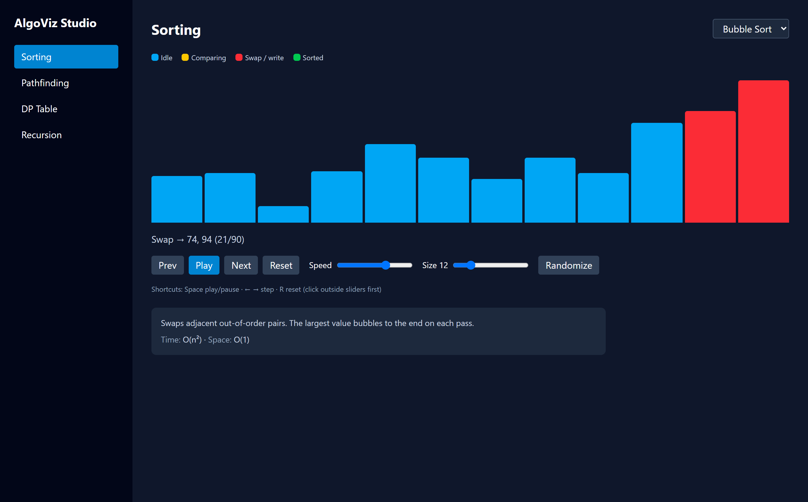
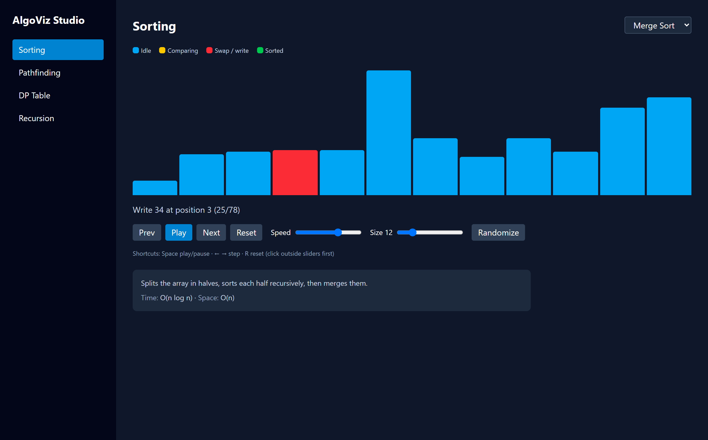
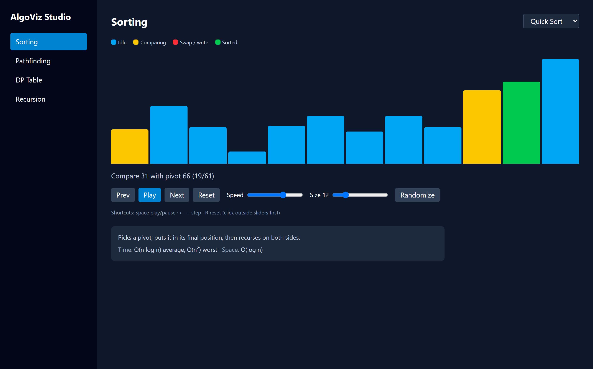
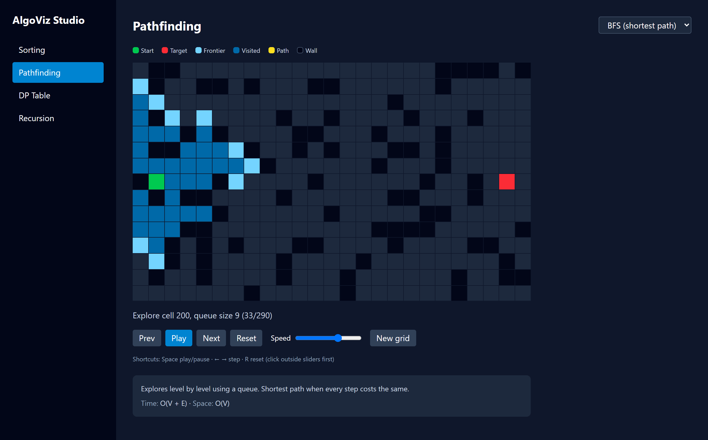
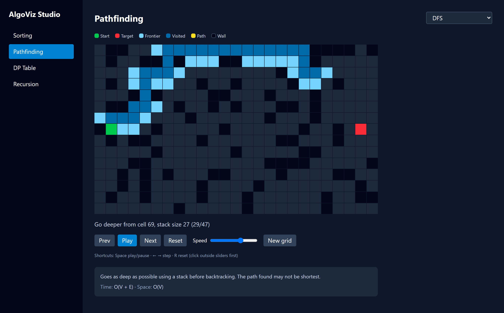
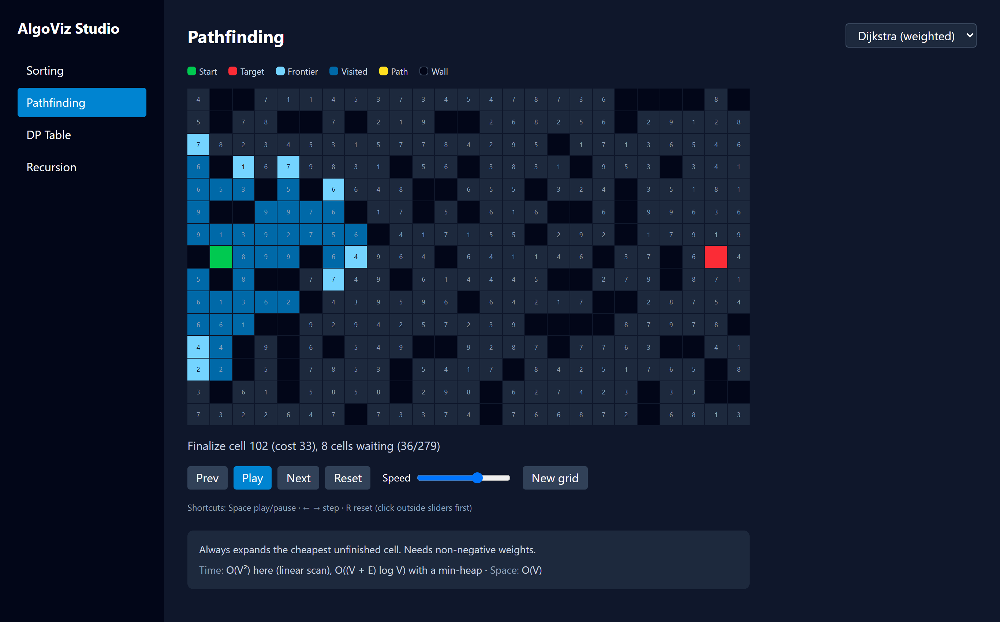
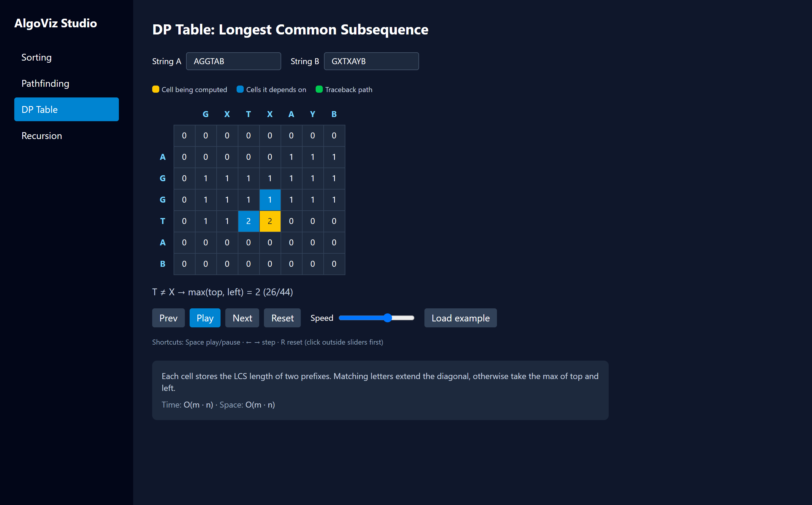
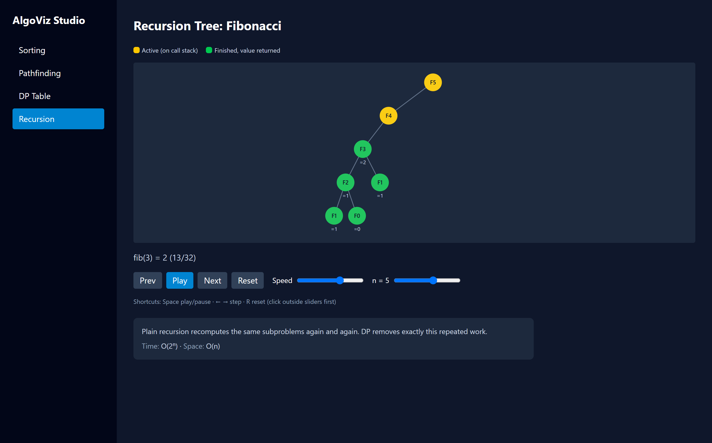

# AlgoViz Studio 🚀

An interactive, responsive algorithm visualizer designed to demystify core computer science algorithms and reinforce **advanced React design patterns**. 

Explore sorting, pathfinding, dynamic programming, and recursion with **time-travel debugging**: play, pause, step forward, step backward, adjust speed, and inspect execution state in real time.



---

## ⚡ React Concepts Mastered

This project was built from the ground up to explore and apply idiomatic React 19 architecture:

- **Generator Functions & Snapshot Architecture:** Algorithms are decoupled from UI rendering. Each algorithm is a pure JavaScript generator that `yield`s state snapshots. This makes backward/forward scrubbing instant ($O(1)$) and keeps algorithm code free from DOM/animation concerns.
- **`useReducer` State Machine:** Centralizes complex, interdependent playback controls (`PLAY`, `PAUSE`, `NEXT`, `PREV`, `RESET`, `SPEED`) in a single deterministic reducer function.
- **`useMemo` Optimization:** Pre-computes and caches generator step arrays `[...generatorFn(input)]`. Stepping back and forth requires zero re-computation of the algorithm.
- **`useEffect` Lifecycle & Cleanup:** Manages the playback timer loop (`setInterval`), guaranteeing proper cleanup (`clearInterval`) on pauses, resets, or unmounts to prevent memory leaks and orphaned timers.
- **Custom Hooks (`usePlayback`, `useHotkeys`):** Abstracts playback logic and global keyboard listener bindings away from UI components for high reusability.
- **Component Composition & State Lifting:** Generic, reusable UI building blocks (`Controls`, `StepLog`, `Legend`, `InfoCard`) composed across all visualizers.
- **Controlled Components:** Dynamic two-way bindings for speed/size range sliders and string input fields with immediate state synchronization.
- **Client-Side SPA Routing:** Multi-page experience powered by React Router v7 with active link indicators.
- **Pure SVG & CSS Grid Rendering:** Smooth, high-performance visualizations built with Tailwind CSS v4 and vanilla SVG without heavyweight charting libraries.

---

## 🧠 Algorithms Showcased

AlgoViz Studio features 8 algorithms across 4 core computer science domains.

### 1. Sorting Algorithms

#### Bubble Sort
Iterates through the list, comparing adjacent items and swapping them if out of order. The highest unsorted value "bubbles" to its final position at the end of each pass.
- **Time Complexity:** $O(n^2)$ worst/average, $O(n)$ best
- **Space Complexity:** $O(1)$ auxiliary


#### Merge Sort
A divide-and-conquer algorithm that recursively splits the array into single-element subarrays and merges them back in sorted order.
- **Time Complexity:** $O(n \log n)$ worst/average/best
- **Space Complexity:** $O(n)$ auxiliary



#### Quick Sort
Selects a pivot, partitions elements smaller than the pivot to the left and larger to the right, and recursively sorts each sub-partition (Lomuto partitioning).
- **Time Complexity:** $O(n \log n)$ average, $O(n^2)$ worst (unbalanced pivot)
- **Space Complexity:** $O(\log n)$ auxiliary (recursion call stack)



---

### 2. Pathfinding & Graph Algorithms

#### Breadth-First Search (BFS)
Explores a 2D grid radially layer by layer using a FIFO queue. Evaluates all neighbors at distance $k$ before distance $k+1$. Guarantees the shortest path on unweighted graphs.
- **Time Complexity:** $O(V + E)$
- **Space Complexity:** $O(V)$ auxiliary (queue & visited set)



#### Depth-First Search (DFS)
Dives deeply along each path branch using a LIFO stack before backtracking when hitting walls or visited cells. Does not guarantee the shortest path.
- **Time Complexity:** $O(V + E)$
- **Space Complexity:** $O(V)$ auxiliary (stack & visited set)



#### Dijkstra's Algorithm
Greedy shortest-path algorithm for weighted graphs with non-negative edge costs. Iteratively expands the cell with the lowest tentative cumulative distance from the start.
- **Time Complexity:** $O(V^2)$ with linear scan / $O((V + E) \log V)$ with min-heap
- **Space Complexity:** $O(V)$ auxiliary (distance table & priority set)



---

### 3. Dynamic Programming

#### Longest Common Subsequence (LCS)
Constructs an $(m+1) \times (n+1)$ dynamic programming matrix where each cell represents the LCS length between prefix substrings. Matching characters take the diagonal value $+1$; mismatches take $\max(\text{top}, \text{left})$. Concludes with path traceback.
- **Time Complexity:** $O(m \cdot n)$
- **Space Complexity:** $O(m \cdot n)$ auxiliary table



---

### 4. Recursion

#### Fibonacci Call Tree
Visualizes the binary recursion call tree for $F(n) = F(n-1) + F(n-2)$. Demonstrates active call frames on the stack (yellow) and resolved subproblem returns (green), making redundant overlapping subproblems visible.
- **Time Complexity:** $O(2^n)$
- **Space Complexity:** $O(n)$ auxiliary (call stack depth)



---

## 📊 Complexity Quick Reference

| Algorithm | Category | Best Time | Average Time | Worst Time | Space Complexity |
|---|---|---|---|---|---|
| **Bubble Sort** | Sorting | $O(n)$ | $O(n^2)$ | $O(n^2)$ | $O(1)$ |
| **Merge Sort** | Sorting | $O(n \log n)$ | $O(n \log n)$ | $O(n \log n)$ | $O(n)$ |
| **Quick Sort** | Sorting | $O(n \log n)$ | $O(n \log n)$ | $O(n^2)$ | $O(\log n)$ |
| **BFS** | Pathfinding | $O(V + E)$ | $O(V + E)$ | $O(V + E)$ | $O(V)$ |
| **DFS** | Pathfinding | $O(V + E)$ | $O(V + E)$ | $O(V + E)$ | $O(V)$ |
| **Dijkstra** | Pathfinding | $O(V^2)$ | $O(V^2)$ | $O(V^2)$ | $O(V)$ |
| **LCS** | Dynamic Prog. | $O(m \cdot n)$ | $O(m \cdot n)$ | $O(m \cdot n)$ | $O(m \cdot n)$ |
| **Fibonacci Tree** | Recursion | $O(2^n)$ | $O(2^n)$ | $O(2^n)$ | $O(n)$ |

---

## 🎮 Controls & Shortcuts

| Action | Control / Key | Description |
|---|---|---|
| **Play / Pause** | <kbd>Space</kbd> or **Play** button | Toggles automated step execution |
| **Step Forward** | <kbd>→</kbd> or **Next** button | Moves exactly one step ahead |
| **Step Backward** | <kbd>←</kbd> or **Prev** button | Steps one snapshot backward (time-travel) |
| **Reset** | <kbd>R</kbd> or **Reset** button | Resets visualizer to initial state |
| **Speed** | Slider (1–10) | Controls interval delay between steps (100ms–950ms) |
| **Size / Input** | Slider / Text input | Adjusts array size, tree depth, or strings |
| **Randomize** | Button | Generates a new random array or obstacle grid |

---

## 🏗️ Architecture & How It Works

Algorithms do not manipulate the DOM directly. Instead, a unidirectional pipeline separates state generation, playback scheduling, and rendering:

```
┌─────────────────────────┐
│ Generator Function      │  Iteratively yields state snapshots:
│ (bubbleSort, bfs, etc.) │  { array / grid / tree, highlights, note }
└────────────┬────────────┘
             │
             ▼
┌─────────────────────────┐
│ useMemo Snapshot Cache  │  Evaluates generator once into memory:
│ [...generator(input)]   │  Enables O(1) arbitrary indexing & scrub
└────────────┬────────────┘
             │
             ▼
┌─────────────────────────┐
│ usePlayback Custom Hook │  useReducer handles index & playback state;
│ (state machine + timer) │  useEffect coordinates setInterval timer loop
└────────────┬────────────┘
             │
             ▼
┌─────────────────────────┐
│ Presentational Views    │  Pure React components:
│ Bars / Grid / DP / Tree │  Renders visual state with Tailwind & SVG
└─────────────────────────┘
```

---

## 📂 Project Structure

```text
algoviz-studio/
├── public/                 # Static assets
├── screenshots/            # High-resolution screenshots of each visualizer
├── scripts/                # Headless Chrome screenshot automation script
├── src/
│   ├── algorithms/         # Pure generator functions & registry
│   │   ├── bfs.js          # Breadth-first search
│   │   ├── bubbleSort.js   # Bubble sort
│   │   ├── dfs.js          # Depth-first search
│   │   ├── dijkstra.js     # Dijkstra's algorithm
│   │   ├── fibTree.js      # Fibonacci recursion tree generator
│   │   ├── gridUtils.js    # Grid setup and random wall generation
│   │   ├── index.js        # Algorithm registries
│   │   ├── lcs.js          # Longest Common Subsequence table & traceback
│   │   ├── mergeSort.js    # Merge sort
│   │   └── quickSort.js    # Quick sort
│   ├── components/         # Modular presentational UI
│   │   ├── Bars.jsx        # Sorting bars with state color transitions
│   │   ├── Controls.jsx    # Unified playback control bar
│   │   ├── DPTable.jsx     # Matrix table for DP cell values & traceback
│   │   ├── FibTree.jsx     # SVG node-link tree renderer
│   │   ├── Grid.jsx        # Pathfinding CSS grid with weights & walls
│   │   ├── InfoCard.jsx    # Complexity and behavior badge card
│   │   ├── Legend.jsx      # Dynamic color indicators
│   │   ├── Sidebar.jsx     # Navigation sidebar
│   │   └── StepLog.jsx     # Current operation log with step counter
│   ├── data/
│   │   └── info.js         # Complexity metadata and algorithm descriptions
│   ├── hooks/
│   │   ├── useHotkeys.js   # Global keyboard shortcuts hook
│   │   └── usePlayback.js  # Generator playback & step reducer engine
│   ├── pages/              # Routed view containers
│   │   ├── DP.jsx          # Dynamic programming visualizer
│   │   ├── Graphs.jsx      # Pathfinding visualizer
│   │   ├── Recursion.jsx   # Recursion tree visualizer
│   │   └── Sorting.jsx     # Sorting visualizer
│   ├── App.jsx             # Shell layout and route definitions
│   ├── main.jsx            # React root mount
│   └── utils.js            # Array generation and helper utilities
├── package.json
└── vite.config.js
```

---

## 🛠️ Getting Started

### Prerequisites
- Node.js (v18 or higher recommended)
- npm or yarn

### Installation

```bash
git clone https://github.com/ABHI2005jeet/AlgoViz-Studio.git
cd AlgoViz-Studio
npm install
```

### Development Server

```bash
npm run dev
```

Navigate to `http://localhost:5173` in your browser.

### Production Build & Preview

```bash
npm run build
npm run preview
```

### Generating Screenshots

To re-capture all algorithm screenshots automatically via headless Chrome:

```bash
npm run screenshots
```

---

## 📜 License

This project is open source and available under the [MIT License](LICENSE).